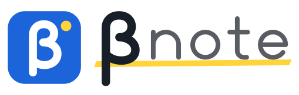
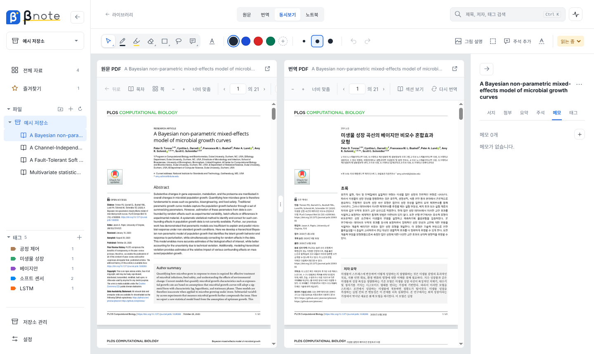
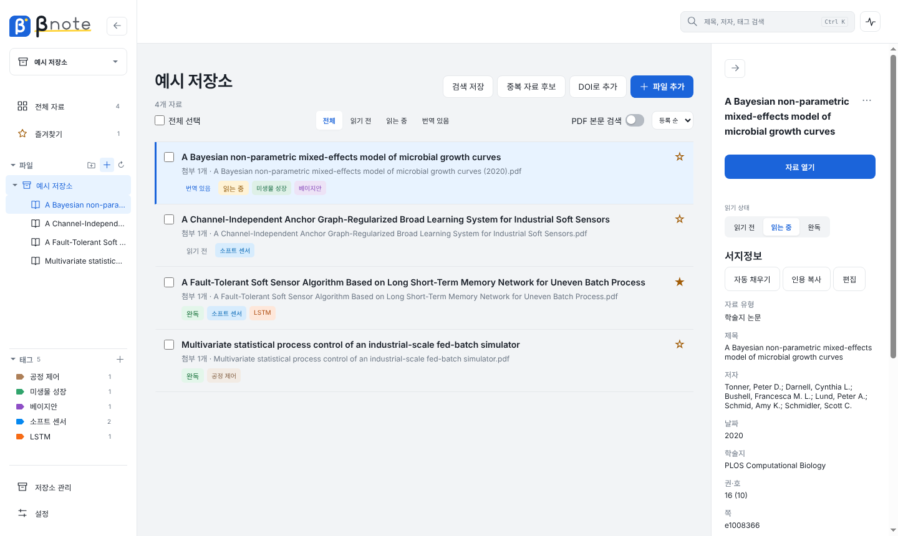
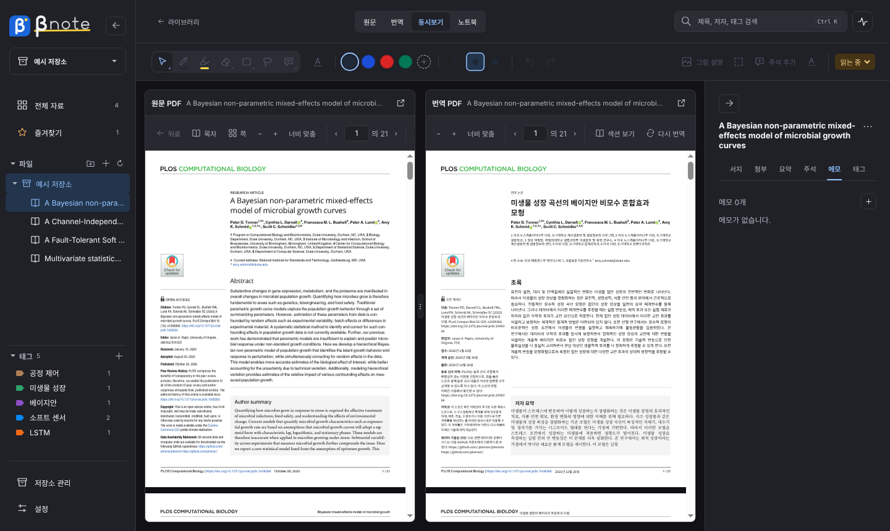

<p align="center">
  
</p>

<h3 align="center">βnote(베타노트): 논문을 원문 배치 그대로 번역해 읽고, 묻고, 그 위에 쓰는 데스크톱 앱</h3>

<p align="center">
  <em>Read research PDFs translated in place, ask about them, and write on them. Everything stays on your computer.</em>
</p>

<p align="center">
  
  
  
  
  
</p>

<p align="center">
  <a href="#빠른-시작">빠른 시작</a> ·
  <a href="#사용-설명서">사용 설명서</a> ·
  <a href="#단축키">단축키</a> ·
  <a href="#내-자료는-어디에-있나요">데이터와 개인정보</a> ·
  <a href="#자주-묻는-질문">자주 묻는 질문</a>
</p>



<p align="center"><sub>원문(왼쪽)과 번역(오른쪽)을 같은 배치로 나란히 봅니다. 오른쪽 번역은 βnote가 실제로 번역한 결과입니다.<br>논문: Tonner et al. (2020), <i>PLOS Computational Biology</i> 16(10): e1008366 · CC0(저작권 없음)</sub></p>

> **이 프로젝트가 도움이 되었다면 오른쪽 위의 ⭐ Star를 눌러 주세요.** 혼자 만들고 있는 프로젝트라, 별 하나가 계속 만들 이유가 됩니다.

---

## 무엇을 하는 프로그램인가요

영어 논문을 읽을 때 번역기에 문단을 붙여 넣으면 그림·수식·단 구성이 사라지고, 번역문과 원문을 오가며 위치를 찾느라 시간이 듭니다. βnote는 **PDF의 배치를 그대로 둔 채** 문단 자리에 번역을 올려 보여 주고, 그 위에서 메모·필기·질문까지 이어서 할 수 있게 합니다.

| | |
|---|---|
| 📄 **배치를 유지한 번역** | 문단 위치, 단 구성, 그림, 수식을 그대로 두고 번역만 바꿉니다. 원문 · 번역 · 동시보기를 오가며 읽고, 번역본을 PDF로 저장합니다. |
| 🤖 **쓰던 AI를 그대로** | ChatGPT 계정, OpenAI · Claude · Gemini API 키, 내 PC의 로컬 모델(Ollama 등) 중에서 고릅니다. |
| 💬 **논문에게 묻기** | 구조화 요약, 고른 문장 설명, 그림 설명, 질문과 답. 답에는 근거가 된 본문 위치가 붙습니다. |
| ✍️ **필기와 메모** | 펜 · 형광펜 · 도형 · 텍스트 상자로 원문과 번역 위에 쓰고, 메모와 노트북에 정리합니다. |
| 📚 **서재 관리** | 서지정보, DOI 조회, 태그, 폴더, 중복 정리, 본문 검색, 인용 복사(APA · Vancouver), RIS · BibTeX 가져오기와 내보내기. |
| 🔒 **내 PC에 저장** | 자료는 내가 고른 폴더에 그대로 있습니다. 계정 가입이 없고, 논문을 보내는 곳은 내가 연결한 AI뿐입니다. |

<details>
<summary><b>화면 더 보기</b></summary>
<br>

**서재** — 폴더, 태그, 읽기 상태로 논문을 정리합니다.



<sub>사진의 논문: Tonner et al. (2020) <i>PLOS Comput. Biol.</i> · CC0 / Zhang et al. (2026) <i>Entropy</i> · CC BY / Liu et al. (2024) <i>Processes</i> · CC BY / Duran-Villalobos et al. (2020) <i>Comput. Chem. Eng.</i> · CC BY. 태그와 읽기 상태는 설명용으로 붙였습니다.</sub>

**어두운 모드**



</details>

---

## 빠른 시작

### 1. 내려받기

[릴리스 페이지](../../releases)에서 운영체제에 맞는 파일을 받습니다. 설치 과정 없이 압축을 풀어 실행하는 방식입니다.

| 운영체제 | 받을 파일 | 실행 |
|---|---|---|
| Windows 10 · 11 (x64) | `betanote-<버전>-windows-x64.zip` | 압축을 모두 푼 뒤 폴더 안의 `betanote.exe` |
| Ubuntu 22.04 이상 (x64) | `betanote-<버전>-linux-x64.tar.gz` | 압축을 푼 뒤 폴더 안의 `betanote` |

> 코드 서명이 없어 Windows가 처음 실행할 때 경고를 보일 수 있습니다. macOS용은 준비 중입니다.

### 2. 저장소 연결

처음 실행하면 **저장소 연결** 버튼이 보입니다. 논문 PDF를 모아 둘 폴더를 하나 고르세요. 이미 PDF가 들어 있는 폴더를 골라도 됩니다. 안의 PDF가 자동으로 목록에 올라옵니다.

### 3. 논문 열기

목록에서 논문을 두 번 누르거나 Enter를 누르면 열립니다.

### 4. 번역하기

위쪽의 **번역** 또는 **동시보기**를 누르고 번역을 시작합니다. 처음에는 쓸 AI를 연결하라는 안내가 나옵니다. 아래 [AI 연결](#ai-연결하기)을 참고하세요.

---

## 사용 설명서

필요한 항목을 눌러 펼쳐 보세요.

<details>
<summary><b>AI 연결하기</b></summary>
<br>

설정 → 연결에서 고릅니다. 번역과 AI 기능(요약 · 질문 · 설명)에 같은 연결을 씁니다.

| 방식 | 필요한 것 | 비용 |
|---|---|---|
| ChatGPT 계정 | ChatGPT 로그인 | 계정의 요금제에 포함된 사용량 |
| API 키 | OpenAI · Anthropic(Claude) · Google(Gemini)의 API 키 | 쓴 만큼 각 회사 계정에 청구 |
| 그 밖의 OpenAI 호환 서비스 | 서비스 주소와 키 | 서비스마다 다름 |
| 로컬 모델 | 내 PC에서 돌아가는 Ollama 또는 OpenAI 호환 서버 | 없음 (PC 성능이 필요) |

- API 키는 운영체제의 보안 저장소로 암호화해 이 PC에만 저장합니다.
- 로컬 모델을 쓰면 논문 내용이 PC 밖으로 나가지 않습니다.

</details>

<details>
<summary><b>번역해서 읽기</b></summary>
<br>

- **보기 전환**: 위쪽 가운데의 `원문` · `번역` · `동시보기` · `노트북`.
- **동시보기**: 원문과 번역이 함께 스크롤됩니다. 가운데 손잡이를 끌어 폭을 조절합니다.
- **섹션 보기**: 번역 창의 `섹션 보기`를 누르면 배치 대신 글 흐름대로 읽습니다.
- **일부만 다시 번역**: 번역 창의 `다시 번역`에서 쪽을 골라 다시 번역할 수 있습니다. 문제가 있는 쪽만 골라 주는 버튼도 있습니다.
- **번역 요청 사항**: 용어나 문체를 지정할 수 있습니다(저장소 전체에 적용하거나 이번 번역에만 적용).
- **용어집**: "이 용어는 이렇게 옮긴다"를 저장소에 등록해 두면 번역에 반영됩니다.
- **번역 고치기**: 번역문을 직접 고칠 수 있고, 고친 내용은 다시 번역해도 남습니다.
- **PDF로 저장**: 번역본을 원문과 같은 배치의 PDF로 저장합니다.
- **새 창으로 보기**: 창 제목 오른쪽의 아이콘으로 원문이나 번역을 따로 띄워 모니터 두 대에서 봅니다.

수식, 표, 그림 안의 글자, 참고문헌 목록은 원문 그대로 둡니다. 스캔한 논문처럼 글자를 읽을 수 없는 쪽은 글자 인식(OCR)으로 읽습니다.

</details>

<details>
<summary><b>AI에게 묻기</b></summary>
<br>

- **구조화 요약**: 연구 질문 · 방법 · 결과 · 한계로 나눠 요약합니다.
- **질문**: 논문에 대해 물으면 근거가 된 본문 위치와 함께 답합니다. 근거가 없으면 없다고 표시합니다.
- **선택 설명**: 문장이나 수식을 끌어 고른 뒤 설명을 요청합니다.
- **그림 설명**: 도구 줄의 `그림 설명`을 누르고 그림 영역을 고릅니다.
- **자료 비교**: 서재에서 여러 논문을 고른 뒤 `AI 비교`.
- **태그 제안**: 논문 내용에 맞는 태그를 제안받습니다.
- **AI 요청 사항**: `저장소 관리 → AI`에 답변 방식을 적어 두면(예: "수식은 LaTeX로 써 주세요") 이 저장소의 AI 답변에 함께 보냅니다(태그 제안과 번역은 제외).

결과는 메모에 넣어 두고 이어서 물을 수 있습니다.

</details>

<details>
<summary><b>필기와 주석</b></summary>
<br>

도구 줄에서 도구를 고릅니다: 선택 · 펜 · 형광펜 · 지우개 · 도형 · 올가미 · 텍스트 상자.

- 같은 도구를 한 번 더 누르면 종류를 바꿉니다(예: 도형 → 직선 · 화살표 · 사각형 · 삼각형).
- 올가미로 필기를 둘러 고르면 옮기기 · 크기 조절 · 색 바꾸기 · 복제가 됩니다.
- 문장을 끌어 고르면 형광펜 · 밑줄 · 주석을 바로 붙일 수 있습니다.
- 필기는 원문과 번역에 각각 따로 저장됩니다.
- PDF로 저장하면 필기가 다른 PDF 프로그램에서도 보이는 표준 주석으로 들어갑니다.

</details>

<details>
<summary><b>메모와 노트북</b></summary>
<br>

**메모** — 오른쪽 패널의 `메모` 탭. 논문마다 여러 개를 쓸 수 있고 Markdown과 수식을 지원합니다. `(p. 3)`처럼 적으면 그 쪽으로 가는 링크가 됩니다. 도구 줄의 `메모 추가`를 누르고 쪽의 한 곳을 누르면 그 자리에 핀이 꽂힌 새 메모가 생깁니다.

**노트북** — 위쪽의 `노트북`. 빈 종이에 필기하면서 논문을 옆에 두고 봅니다.

- 도구 줄의 페이지 추가 아이콘으로 줄 · 격자 · 빈 종이를 추가하거나 다른 PDF의 쪽을 가져옵니다.
- 텍스트 상자, 출처 카드(논문의 쪽과 문장으로 돌아가는 링크), 논문에서 잘라 온 그림, 메모를 종이에 올릴 수 있습니다.
- 페이지 추가에서 `화이트보드`를 고르면 폭만 정해진 쪽이 생기고, 아래쪽에 쓸수록 계속 길어집니다(A4 100장까지). 남은 빈 아래쪽은 `⋯`의 `빈 아래쪽 잘라내기`로 줄이고, PDF로 저장하면 같은 폭의 A4 비율 쪽들로 나뉩니다.
- 쪽 오른쪽 위의 `⋯`에서 양식 변경 · 복제 · 순서 변경 · 삭제를 합니다.
- 노트북을 PDF로 저장할 수 있습니다.

</details>

<details>
<summary><b>서재 정리</b></summary>
<br>

- **추가**: `파일 추가`, 또는 저장소 폴더에 PDF를 직접 넣어도 자동으로 올라옵니다. `DOI로 추가`도 됩니다.
- **서지정보**: 오른쪽 패널의 `자동 채우기`가 PDF의 DOI나 제목으로 저자 · 연도 · 학술지를 채웁니다.
- **폴더**: 왼쪽 파일 트리에서 만들고, 끌어서 옮깁니다. 실제 디스크의 폴더와 같습니다.
- **태그와 읽기 상태**: 읽기 전 · 읽는 중 · 완독. 읽은 쪽에 따라 자동으로 바뀝니다.
- **여러 개 한꺼번에**: 목록의 체크박스나 `전체 선택`으로 고른 뒤 이동 · 이름 정리 · 태그 · 내보내기 · 삭제.
- **중복 정리**: `중복 자료 후보`에서 같은 PDF나 같은 DOI를 가진 자료를 합칩니다.
- **검색**: 제목 · 저자 · 태그에 더해 메모 · 요약 · 주석, PDF 위 텍스트 상자, 노트북(제목 · 텍스트 상자 · 출처 카드)의 글까지 찾습니다. 찾은 자료 아래에 찾은 곳(종류 · 쪽 · 앞뒤 글)이 보이고, 누르면 그 자리로 갑니다. `PDF 본문 검색`을 켜면 본문까지 찾습니다.
- **인용**: APA 7 · Vancouver 형식으로 복사합니다.
- **가져오기 · 내보내기**: RIS · BibTeX · BibLaTeX · CSL JSON. Zotero 등에서 내보낸 파일을 가져올 때 PDF 첨부도 함께 가져올 수 있습니다.

</details>

<details>
<summary><b>백업과 여러 PC에서 쓰기</b></summary>
<br>

- **자동 백업**: 서지와 메모 기록은 바뀔 때마다 저장소 안에 백업이 남습니다. 저장소 관리 → 백업에서 되돌립니다.
- **전체 백업**: PDF까지 포함한 한 개의 파일로 내보내고 새 폴더에 복원합니다.
- **휴지통**: 삭제한 자료는 저장소 관리의 휴지통에서 되살릴 수 있습니다.
- **여러 PC**: 저장소 관리 → 동기화에서 Dropbox · Google Drive 같은 공유 폴더를 지정하면, 각 PC의 변경을 기록 단위로 합칩니다. 양쪽에서 같은 메모를 고쳤다면 둘 다 남깁니다.

</details>

<details>
<summary><b>모양 바꾸기</b></summary>
<br>

설정에서 밝게 · 어둡게 · 시스템 따르기를 고릅니다. CSS로 직접 만든 테마와 스니펫도 적용할 수 있습니다.

</details>

<details>
<summary><b>언어 바꾸기</b></summary>
<br>

설정 → 언어에서 세 가지를 따로 정합니다.

| 설정 | 고를 수 있는 것 |
|---|---|
| 화면 언어 | 한국어 · English. 처음 실행할 때는 운영체제 언어를 따릅니다. |
| AI 답변 언어 | 한국어 · English · 中文(简体) · 日本語 · Français · Deutsch · Español · Italiano |
| 번역 결과 언어 | 한국어 |

화면 언어를 바꾸면 메모를 저장한 뒤 창을 다시 불러옵니다. AI 답변 언어는 다음 요청부터 적용됩니다.

</details>

<details>
<summary><b>알아 둘 제한</b></summary>
<br>

| 항목 | 제한 |
|---|---|
| PDF 한 개의 크기 | 100MB까지 |
| 번역할 수 있는 쪽수 | PDF 한 개에 500쪽까지 |
| 글자 인식(OCR) | 영어만 |
| 번역 결과 언어 | 한국어만 |
| 운영체제 | Windows 10 · 11, Ubuntu 22.04 이상 (x64). macOS는 준비 중 |

</details>

---

## 단축키

앱에서 `?` 또는 `F1`을 누르면 전체 목록이 나옵니다.

| 어디서 | 키 | 동작 |
|---|---|---|
| 어디서나 | `Ctrl+K` | 검색(서지 · 메모 · 주석 · 텍스트 상자 · 노트북) |
| | `Ctrl+O` | 저장소 열기 |
| | `Ctrl+Shift+O` | 파일 추가 |
| | `Ctrl+S` | PDF로 저장 |
| | `Ctrl+,` | 설정 |
| | `F5` | 파일 목록 새로고침 |
| 서재 | `Enter` | 고른 자료 열기 |
| | `Ctrl+A` | 전체 선택 |
| | `F2` | 이름 바꾸기 |
| 읽기 | `Ctrl+F` | 본문에서 찾기 |
| | `Ctrl+휠` | 확대 · 축소 |
| 필기 | `Ctrl+1` ~ `9` | 도구 고르기 |
| | `Shift+1` ~ `9` | 색 고르기 |
| | `Ctrl+Z` · `Ctrl+Y` | 실행 취소 · 다시 실행 |
| 문장을 고른 뒤 | `H` · `U` · `N` | 형광펜 · 밑줄 · 주석 |

---

## 내 자료는 어디에 있나요

- **PDF**: 내가 고른 저장소 폴더에 원래 이름 그대로 있습니다. 탐색기에서 그대로 열 수 있습니다.
- **서지 · 메모 · 번역 · 필기**: 같은 폴더 안의 숨김 폴더 `.betanote`에 있습니다. 폴더를 통째로 복사하면 전부 옮겨집니다.
- **밖으로 나가는 것**:
  - 번역이나 AI 기능을 쓸 때, 그 논문의 해당 부분이 **내가 연결한 AI 서비스**로 갑니다. 로컬 모델을 쓰면 나가지 않습니다.
  - 스캔한 쪽을 번역하거나 그림 설명을 요청할 때는 글자와 함께 **그 쪽이나 그림의 이미지**도 같은 AI 서비스로 갑니다.
  - `자동 채우기`를 쓸 때, DOI 또는 제목과 첫 저자가 서지 조회 서비스(Crossref · DataCite)로 갑니다.
- **보내지 않는 것**: 사용 기록, 오류 보고, 통계. 앱은 어디에도 자동으로 보내지 않습니다. 오류 기록은 PC에만 남고, 도움말 → 진단 정보 복사로 직접 복사했을 때만 밖으로 나갑니다. 그 기록에는 논문 내용, 메모, 파일 경로, 키를 넣지 않습니다.
- 계정 가입이 없습니다.

---

## 자주 묻는 질문

<details>
<summary><b>무료인가요?</b></summary>
<br>

지금은 무료로 받아 쓸 수 있습니다. 번역과 AI 기능은 내가 연결한 AI 서비스의 사용량을 쓰므로, API 키를 쓰면 그 회사에 요금이 청구됩니다. 로컬 모델은 비용이 없습니다.

</details>

<details>
<summary><b>어떤 언어로 번역되나요?</b></summary>
<br>

번역 결과는 지금 한국어 하나입니다. 다른 번역 언어(중국어, 일본어, 프랑스어, 독일어, 스페인어, 이탈리아어)는 준비 중입니다. 화면은 한국어와 영어 중에서, AI 답변(요약 · 질문 · 설명)은 8개 언어 중에서 고를 수 있습니다([언어 바꾸기](#사용-설명서)).

</details>

<details>
<summary><b>번역 품질은 어떤가요?</b></summary>
<br>

번역문 자체의 품질은 연결한 모델에 달려 있습니다. 이 앱이 맡는 것은 문단을 정확히 나누고, 수식과 표를 지키고, 번역을 원래 자리에 맞춰 넣는 일입니다. 논문마다 배치가 달라 어긋나는 곳이 있을 수 있고, 그런 쪽은 다시 번역하거나 섹션 보기로 읽을 수 있습니다.

</details>

<details>
<summary><b>스캔한 논문도 되나요?</b></summary>
<br>

됩니다. 글자가 그림으로 된 쪽은 PC 안에서 글자 인식(영어)으로 읽습니다. 인식 품질에 따라 결과가 달라집니다.

</details>

<details>
<summary><b>저장소가 열리지 않거나 문제가 생기면?</b></summary>
<br>

1. 저장소 관리 → 백업에서 이전 상태로 되돌릴 수 있습니다. PDF는 백업 복원으로 바뀌지 않습니다.
2. 도움말 → 진단 정보 복사로 오류 기록을 복사해 [이슈](../../issues)에 붙여 주세요. 운영체제와 앱 버전, 문제가 생긴 순서를 함께 적어 주시면 찾기 쉽습니다.

</details>

<details>
<summary><b>Zotero에서 옮겨 올 수 있나요?</b></summary>
<br>

Zotero에서 "파일 내보내기"를 켜고 BibTeX이나 RIS로 내보낸 뒤, 저장소 관리 → 서지 → 가져오기에서 그 파일을 고르면 서지와 PDF가 함께 들어옵니다. 컬렉션 · 메모 · 주석은 옮겨지지 않습니다.

</details>

---

## 앞으로

- 번역 결과 언어 추가 (중국어 · 일본어 · 프랑스어 · 독일어 · 스페인어 · 이탈리아어)
- macOS
- 설치 프로그램과 업데이트 알림

원하는 기능이 있으면 [이슈](../../issues)로 알려 주세요.

---

## 참여하기

- **⭐ Star** — 가장 쉽고 큰 도움입니다.
- **이슈** — 버그 신고, 기능 제안, 사용 후기를 환영합니다. 잘 안 되는 논문이 있다면 어떤 종류의 논문인지 알려 주세요(논문 파일 자체는 올리지 말아 주세요).
- **코드 기여** — 당분간 받지 않습니다. 자세한 내용은 [CONTRIBUTING.md](CONTRIBUTING.md).

## 개발자를 위한 안내

```sh
npm ci
npm run dev
```

구조, 시험, 저장 형식, 번역 유지보수 기준은 [개발 문서](docs/DEVELOPMENT.md)에 있습니다.

## 라이선스

βnote는 [GNU Affero General Public License v3.0](LICENSE)(AGPL-3.0-only)으로 공개합니다.

- 누구나 쓰고, 고치고, 다시 배포할 수 있습니다. 고친 것을 배포하거나 네트워크로 서비스할 때는 같은 라이선스로 소스를 공개해야 합니다.
- 소스를 공개하지 않고 제품에 넣거나 배포하려면 별도의 상업 라이선스가 필요합니다. [COMMERCIAL.md](COMMERCIAL.md)를 확인하세요.
- 코드 기여는 당분간 받지 않습니다. 받게 되면 [기여자 동의(CLA)](CLA.md)가 필요합니다.
- 포함된 서드파티 구성 요소는 각자의 라이선스를 따릅니다([THIRD_PARTY_NOTICES.md](THIRD_PARTY_NOTICES.md)).
- **이름과 로고.** 라이선스는 코드에 대한 것입니다. βnote라는 이름과 로고의 사용권은 포함하지 않습니다. 고쳐서 배포할 때는 다른 이름과 로고를 써 주세요.

Copyright (C) 2026 βnote 저작권자 (GitHub: abc-engineer)

이 프로그램은 이전에 다른 이름으로 개발됐고, 그때 만든 저장소·설정·동기화 폴더는 처음 열 때 새 이름으로 넘겨받아 그대로 이어서 열립니다. 동기화하는 PC는 모두 함께 새 앱으로 바꿔 주세요. Linux에서는 API 키와 ChatGPT 연결을 한 번 다시 해야 할 수 있고, 인용 키를 직접 정하지 않은 자료의 기본 인용 키는 `beta<번호>`가 됩니다(예전 키로 인용한 원고가 있다면 그 키를 자료의 인용 키 칸에 적어 두세요).

<p align="center">
  <br>
  <sub>읽는 시간을 줄이고, 생각하는 시간을 늘립니다.</sub>
</p>
